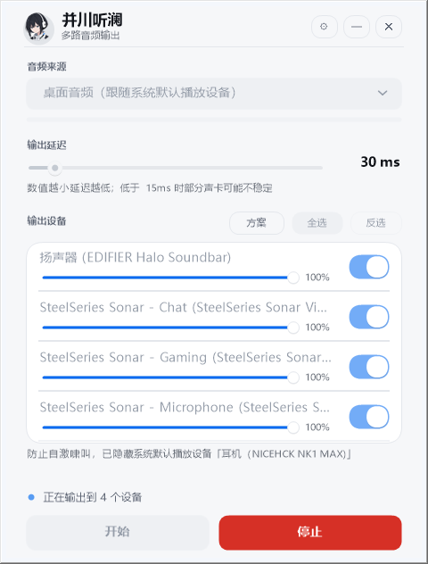
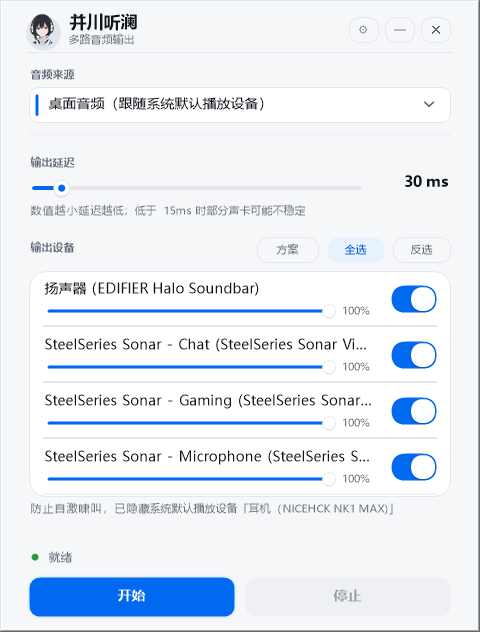

# 并川听澜 · MultiAudioOutput

> 把电脑里正在播放的声音，**同时**送到多个音频输出设备。

Windows 自带的声音设置只能选一个默认播放设备；「立体声混音」要手动开、采样率对不上、
还常常把麦克风和系统音混在一起。并川听澜用 **WASAPI 环回采集** 抓「系统正在播放的声音」，
再逐路送到你勾选的每一台设备，每路可独立调节音量，全程不经过声卡驱动层的虚拟设备。

界面是 iOS 风格的无边框窗口，中文，单文件 exe，**不需要安装 .NET 运行时**（用系统自带的 .NET Framework 4.8）。

<p align="center">
  
  &nbsp;&nbsp;
  
</p>

---

## 它解决什么问题

| 场景 | 并川听澜的做法 |
| --- | --- |
| 同时用耳机 + 音箱 + USB 声卡，想让它们一起响 | 勾选多台输出设备，声音并行送到每一台 |
| 边打游戏边直播，游戏音要走耳机、又要进直播采集卡 | 把「采集卡」和「耳机」都勾上，一路不落 |
| 语音时把系统音送到「SteelSeries Sonar - Chat」这类虚拟设备做混音 | 任意 WASAPI 输出设备都可以作为目标 |
| 不同设备音量不一样，吵得难受 | 每台设备一条独立音量滑杆（0–100%） |

## 特性

- **WASAPI 环回采集**：抓的是「电脑里正在放的声音」，不是麦克风；系统换默认输出设备也能跟着换
- **多路并行输出**：一次送到任意多台设备，单台设备掉线不影响其余几路（逐路 try，失败的那一路单独标记）
- **每路独立音量**：`PcmGain` 在内存里做 16/24/32-bit 定点增益，不额外增加一层重采样
- **设备热插拔**：`DeviceWatcher` 监听 `IMMNotificationClient`，插拔耳机/声卡时列表自动刷新，不需要重启
- **防自激啸叫**：默认播放设备会从输出列表里被剔除并给出提示 —— 否则声音会「采集→输出→再被采集」，一按开始就是刺耳的正反馈啸叫
- **设备方案（预设）**：把常用的一组设备 + 各自音量存成方案，一键切换，最多 12 个
- **全局热键**：默认 `Ctrl+Alt+M` 开始/停止，可在设置面板里改，也可清除
- **开机自启**：写 `HKCU\Software\Microsoft\Windows\CurrentVersion\Run`，不需要管理员权限
- **托盘常驻**：关窗只是收进托盘，音频链路完全不受影响；左键单击图标即唤回窗口
- **高 DPI 正确**：自带 `permonitorv2` manifest，125% / 150% 缩放下不模糊、不拉伸
- **崩溃不静默**：未处理异常写入 `%APPDATA%\MultiAudioOutput\crash.log` 并弹窗告知路径

## 系统要求

| 项目 | 要求 |
| --- | --- |
| 操作系统 | Windows 10 / 11（x64） |
| 运行时 | .NET Framework 4.8（Win10 1903+ / Win11 自带） |
| 音频 | 任意 WASAPI 输出设备；采集依赖系统「默认播放设备」 |
| 权限 | 普通用户即可。只有**安装**时需要管理员（装到 `Program Files`） |

> 采集的是系统默认播放设备的环回信号。如果你把默认播放设备设成一台虚拟声卡（如 VoiceMeeter），
> 采集到的就是那台虚拟声卡的输出 —— 这通常正是直播场景想要的行为。

## 下载

到 [Releases](../../releases) 下载 `并川听澜-x.y-Setup.exe`，双击安装即可。

- 安装包自带 UAC manifest，双击会请求管理员权限（安装到 `Program Files\MultiAudioOutput`）
- 安装器会在写入后逐字节校验 payload（SHA256 + 字节数），装坏了会当场报错而不是装出一个跑不起来的程序
- 卸载走「设置 → 应用 → 已安装的应用」，会清理安装目录与开机自启项
- **不信任预编译产物？** 直接按下面的步骤从源码构建，`build.ps1` 会自己校验图标资源、manifest 和 DPI 声明是否真的进了 exe

## 从源码构建

只需要 Windows 自带的组件，**不装 Visual Studio、不装 .NET SDK**：

```powershell
git clone https://github.com/Seruo-1109/bingchuan-tinglan.git
cd bingchuan-tinglan

# 编译出 build\并川听澜.exe（用系统自带的 csc.exe，.NET Framework 4.8）
powershell -NoProfile -ExecutionPolicy Bypass -File build.ps1
```

产物：`build\并川听澜.exe` + `build\NAudio.dll`（两个文件必须放在一起）。

`build.ps1` 不是简单地调一次编译器，它会在编译后**回读产物做断言**：

- 托管资源里必须有 `AppIcon.ico` / `Avatar0..2.png`（否则窗口图标会静默退回 WinForms 默认图标）
- PE 里必须有 `permonitorv2` 和 `asInvoker`（否则进程是 DPI 无感知的，Windows 会位图拉伸整个窗口）
- 缺 `NAudio.dll` 时**直接报错**，而不是编出一个启动就 `FileNotFoundException` 的 exe

### 打安装包（可选）

```powershell
winget install NSIS.NSIS          # 或用 packaging\_tools\nsis-3.11\makensis.exe
powershell -NoProfile -ExecutionPolicy Bypass -File packaging\build.ps1
```

产物：`packaging\dist\并川听澜-<版本>-Setup.exe` + `.sha256`。

安装包脚本会依次校验 PE 头、UAC manifest、嵌入图标、版本资源四段式，并断言安装包体积不小于
payload 的压缩下限 —— 这一步能抓住「`File` 指令没生效、安装包装出来是空壳」这类事故。

## 使用

1. **音频来源**：默认「桌面音频（跟随系统默认播放设备）」，也可以在下拉里指定另一台设备
2. **输出延迟**：默认 30 ms，可调 5–300 ms。数值越小延迟越低，低于 15 ms 时部分声卡会开始爆音
3. **输出设备**：勾选要出声的每一台设备，拖动右侧滑杆调该路音量
4. 点 **开始**，状态行显示「正在输出到 N 个设备」；点 **停止** 断开
5. 常用组合存成 **方案**，下次一键切回

托盘图标：左键单击唤回窗口，右键弹菜单（开始/停止、方案、设置、退出）。

## 项目结构

```
bingchuan-tinglan/
├── build.ps1                    # 主构建脚本：csc 编译 + 产物断言
├── app.ico                      # 应用图标（多尺寸）
├── src/                         # 全部源码（C# 5 / .NET Framework 4.8 / WinForms）
│   ├── Program.cs               # 入口：命令行探针、单实例、全局异常兜底
│   ├── MainForm.cs              # 主窗口：布局、状态机、设备列表编排
│   ├── AudioEngine.cs           # WASAPI 环回采集 + 多路输出（线程模型在此注释里）
│   ├── PcmGain.cs               # 定点 PCM 音量增益（16/24/32-bit）
│   ├── DeviceWatcher.cs         # IMMNotificationClient 热插拔监听
│   ├── DeviceListView.cs        # 自绘设备卡片列表（滑杆 + 开关）
│   ├── UiKit.cs / Theme.cs      # 自绘控件与配色、DPI 缩放
│   ├── Settings.cs              # settings.json 持久化 + 归一化
│   ├── ProfileMenu.cs           # 设备方案（预设）菜单
│   ├── SettingsPanel.cs         # 设置面板：开机自启 + 全局热键
│   ├── HotKey.cs / AutoStart.cs # RegisterHotKey / HKCU Run 项
│   ├── TrayHost.cs              # 托盘图标与右键菜单
│   ├── AppIcon.cs / AvatarArt.cs# 从托管资源取图标与头像
│   ├── SelfTest.cs / Shot.cs …  # 开发期探针（--selftest / --shot / --stress …）
│   └── IconStudio.cs            # 设计期图标生成器（不参与主构建）
├── res/                         # 角色头像（三个表情，192×192 PNG）
├── lib/NAudio.dll               # 唯一第三方依赖，随仓库分发
├── packaging/                   # NSIS 安装包工程
│   ├── build.ps1                # 打包 + 产物校验
│   ├── installer/installer.nsi  # 安装器脚本（含写入后 SHA256 自检）
│   └── assets/                  # 安装向导位图与生成脚本
└── screenshots/                 # 界面截图
```

## 开发期探针

主程序内置了几个只在开发时用的入口，正常启动不会触发：

| 参数 | 作用 |
| --- | --- |
| `--selftest <dir>` | 配置读写、归一化、路径等纯逻辑自检 |
| `--shot <dir> [w] [h]` | 把窗口移到屏幕外截图，输出到 `<dir>` |
| `--paintprobe <dir> [rounds]` | 反复触发重绘，统计无效绘制与异常 |
| `--leakprobe <dir>` | 反复起停音频引擎，统计 GDI / 句柄 / MMDevice 泄漏 |
| `--stress <dir> [rounds]` | 故意写坏 settings.json 验证归一化不崩 |

这些入口都会先调用 `TestGuard.Begin()`，把真实配置挪走再跑、跑完原样放回 ——
早期版本就是因为 `--shot` 把「全选设备 + 窗口在屏幕外」写进了用户真实配置，
导致下次正常启动时窗口出现在屏幕外。

`--minimized` / `--autostart` 是面向用户的参数：启动后只留在托盘。

## 设计取舍

- **为什么用 csc.exe 而不是 MSBuild / 项目文件**：整个程序是 26 个 `.cs` 的 WinForms 单程序集，
  用系统自带的 `csc.exe` 一行命令就能编出来，不需要 NuGet 还原、不需要 SDK。
  代价是资源与 manifest 必须用 `/resource:` `/win32icon:` `/win32manifest:` 显式声明，
  所以 `build.ps1` 才要在编译后回读产物断言。
- **为什么采集用 WASAPI 环回而不是虚拟声卡**：虚拟声卡要用户手动装驱动、改默认设备，
  还会把系统音和麦克风混在一起。环回采集是「旁听」默认渲染端点，对系统零侵入。
- **为什么剔除默认播放设备**：采集源和输出目标是同一台设备时会形成正反馈回路，
  不是音质问题而是安全/体验问题，所以宁可少一个可选目标也要挡住。
- **为什么音量用定点 PCM 增益**：走 NAudio 的重采样/音量组件会再引入一层缓冲和延迟；
  直接在字节层面乘系数，16/24/32-bit 各一套路径，代价可控且不改变采样率。

## 已知限制

- 只支持 Windows（WASAPI 是 Windows 专有）
- 采集源只能是「渲染端点」（系统正在播放的声音），不支持直接采集麦克风输入
- 每路输出共用同一个采样率/声道数（取自采集端），不做逐路重采样
- 未做代码签名：首次运行时 SmartScreen 会提示「更多信息 → 仍要运行」

## 第三方

- [NAudio](https://github.com/naudio/NAudio) 1.10.0 —— MIT License, © 2020 Mark Heath。
  仓库内 `lib/NAudio.dll` 为该库的未修改二进制副本，许可证全文见 `lib/NAudio-LICENSE.txt`。
- 界面字体使用系统自带的微软雅黑 / Segoe UI，不随程序分发。

## 许可证

[GPL-3.0](LICENSE)。简单说：你可以自由使用、修改、分发，包括商用；
但**如果你分发修改后的版本，必须同样以 GPL-3.0 开源**。

## 致谢

角色头像与图标为项目原创素材，仅用于本程序的界面装饰。
